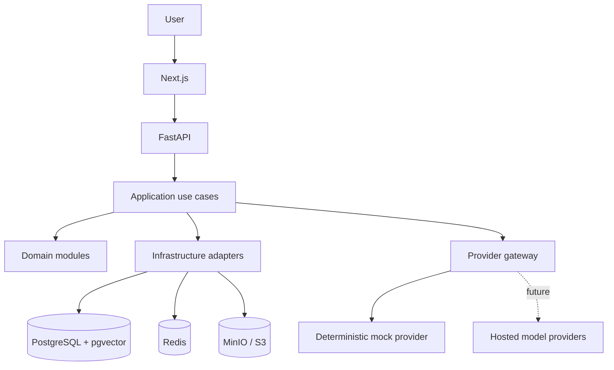

# Architecture — initial local foundation

## Context
The product combines a no-code assistant builder with an advanced multi-agent studio. The initial implementation uses a modular monolith and separate worker processes. It is intentionally local-first.

## Container topology
- `frontend`: Next.js UI on host port 3000.
- `backend`: FastAPI on host port 8000.
- `postgres`: PostgreSQL 16 + pgvector on host port 5432.
- `redis`: queue/cache on host port 6379.
- `minio`: S3-compatible local object store on ports 9000/9001.

## Logical architecture

## Backend boundaries
- `api`: HTTP transport only.
- `core`: settings, errors and shared primitives.
- `modules/projects`: project domain and use cases.
- `modules/assistants`: assistant domain and use cases.
- `providers`: external model adapters.
- `infrastructure`: persistence and external infrastructure.

The initial scaffold is intentionally small. New modules should follow the same boundary pattern rather than creating cross-module imports into private implementation details.

## Data and trust boundaries
- Uploaded files and retrieved text are untrusted data.
- Model output is untrusted until validated.
- Secrets remain server-side.
- SQL connectors must use read-only credentials, allowlisted schemas/views, query validation, row caps and timeouts.
- Website connectors must defend against SSRF, redirects to private IP ranges and unsafe protocols.
- Every tenant-owned resource must be authorized against the active organization. PostgreSQL RLS is a required next-stage control, not yet implemented in this scaffold.

## AI quality design
The intended workflow is:
1. classify and plan,
2. retrieve evidence from authorized sources,
3. draft an answer with claim-level citations,
4. independently review claims,
5. arbitrate based on evidence and source authority,
6. correct, abstain or request human review.

Multiple model votes are not proof. A validated claim must be supported by relevant evidence. If evidence is absent or contradictory, the assistant must say so.

## Deployment evolution
Local Docker Compose is the first target. Production should use European-region managed or self-hosted infrastructure, managed secrets, encrypted backups, TLS, WAF, monitoring, CI/CD and documented processor/data-transfer reviews. Local Compose settings are not production security settings.
